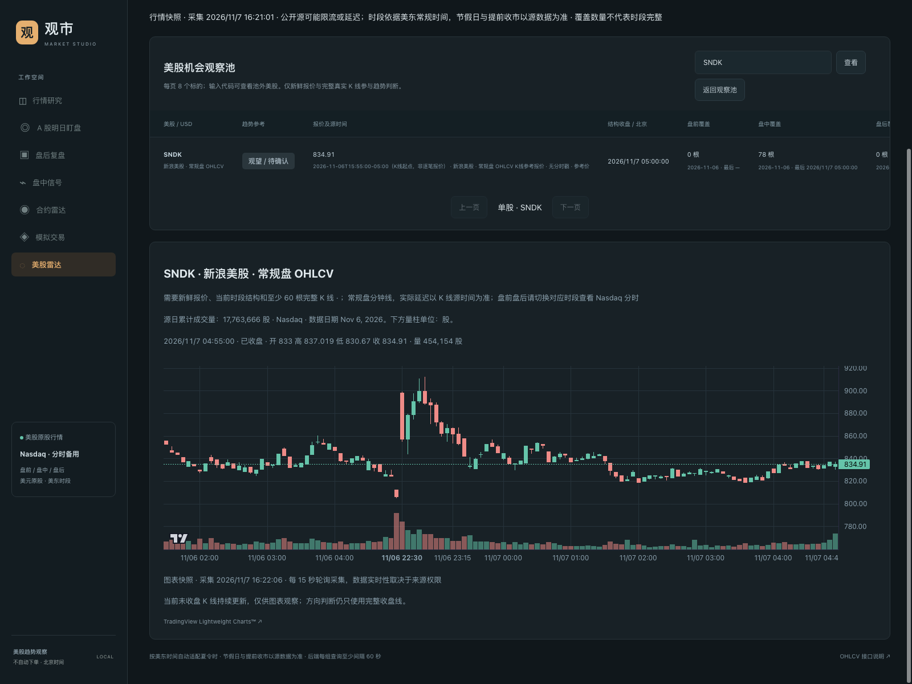
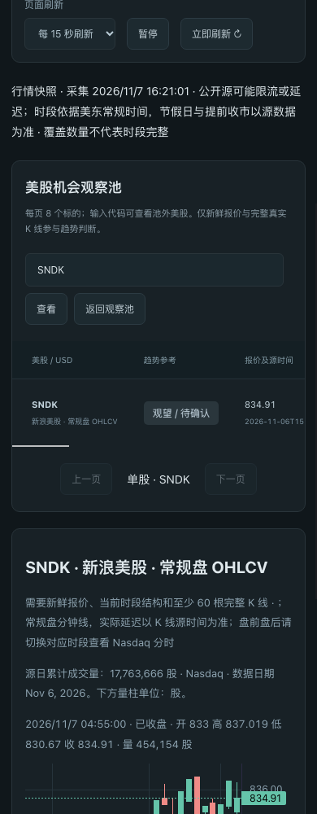
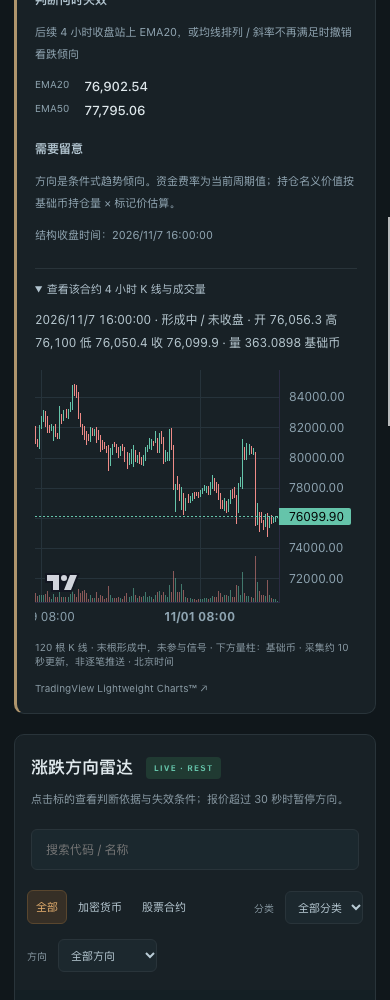

# Market Studio — Python Stock Market Dashboard, Stock Screener & Paper Trading

> **Complete source and research materials are now public.** Strategy experiments and trade replays are included. Usage rights are governed by [LICENSE](LICENSE); see the [publication policy](CONFIDENTIALITY.md).

**A local research workspace for China A-shares, US equities and cryptocurrency perpetual futures.**

[简体中文](README.md) · **English** · [Quick start](#quick-start) · [Screenshots](#screenshots) · [Issues](https://github.com/476139183/ai-MarketDashboard/issues)

**Market Studio / 观市** (`ai-MarketDashboard`) combines stock market scanners, candlestick and volume charts, technical signals, exchange-specific futures monitoring, paper trading and optional AI stock analysis. It runs on your machine with a Python HTTP server, a vanilla JavaScript frontend and local SQLite account storage.

Public US intraday charts and crypto futures modules can run without DSA, exchange account credentials, an AI model key or an npm build. Full stock research and AI reports use a separate Daily Stock Analysis service.

> **Research and simulation only.** Prices update through HTTP polling and remain subject to provider delays and entitlements. The application does not submit orders to a brokerage or an exchange.

## Market structure overlays

Daily China/US equity charts, US intraday charts and perpetual charts share confirmed swing labels, BOS/CHoCH events, premium/discount zones and three-candle price gaps. Layers are independently switchable; swing confirmation waits for 3/5/10 right-hand closed bars. See the [timing and data limitations](docs/features/market-structure.md).

## What you can do

| Module | Market | Capabilities |
|---|---|---|
| Stock research | China A-shares and US stocks | Symbol/name search, daily candlesticks, volume, moving averages, browser watchlists and manually requested AI reports |
| Intraday stock signals | A-shares and US stocks | Daily price/volume bias, closed 15-minute state, conditional entry zones and risk references |
| A-share scanner | Filtered popularity universe | End-of-day trend candidates, observation lists and next-session plans |
| A-share market review | Indices, breadth and sectors | Market tone, advancing/declining stocks and sector performance |
| US stock radar | Original US equities, priced in USD | Intraday OHLCV, 1–60 minute charts and pre-market/regular/after-hours filters |
| Perpetual futures radar | USDT perpetuals | OKX, Binance and Bitget market data, EMA trends, funding and estimated open-interest notional |
| Paper trading | OKX and Binance contracts | Rule-based simulated entries/exits, fees, slippage, position valuation and persistent history |
| Historical research | Available public samples | Imports, coverage audits, rule comparisons and replay tools |

### Design choices

- **Separate markets and products.** US equity prices are not used as execution prices for exchange-listed stock perpetuals.
- **Inspect the source.** Quotes, closed-bar times, collection times, missing values and provider errors are displayed separately.
- **Keep unfinished bars out of signals.** A forming candlestick can update on the chart while strategy decisions still use closed bars.
- **Keep simulation accounts independent.** OKX crypto, OKX stock perpetuals and Binance crypto have separate balances, positions and histories.
- **Request AI explicitly.** Browsing quotes or switching symbols does not automatically submit a new model analysis.
- **Start with a small runtime.** Core public-data modules use the Python standard library and prepackaged browser chart assets.

## Screenshots

Actual SNDK five-minute candles and per-bar share volume, with separate provider and date labels:



<details>
<summary>Mobile US equity and perpetual futures charts</summary>

| US equity OHLCV | Perpetual futures chart |
|---|---|
|  |  |

</details>

Screenshots were captured on November 7, 2026. They illustrate the interface, not current quotes or investment performance.

## Quick start

### Requirements

- Python 3.10+ and Git. Local validation used Python 3.13 on macOS.
- A modern web browser and backend access to the selected data providers.
- Bash for the full-workspace launcher; direct Python startup does not require that launcher.
- Node.js for frontend tests only. There is no frontend build step.

Other operating systems have not received the same compatibility validation. Windows users can try WSL; this is not a claim of verified native Windows support.

### 1. Clone the main branch

The features described here are available on the default `main` branch:

```bash
git clone --branch main https://github.com/476139183/ai-MarketDashboard.git
cd ai-MarketDashboard
```

For an existing checkout, save local changes before switching to and updating `main`.

### 2. Run the lightweight workspace

```bash
BOARD_PORT=8766 python3 markets/us/dashboard/app.py
```

Open:

| Page | Local URL |
|---|---|
| US stock radar | http://127.0.0.1:8766/us-radar |
| Perpetual futures radar | http://127.0.0.1:8766/contracts |
| Paper trading | http://127.0.0.1:8766/paper |
| OKX stock-perpetual paper account | http://127.0.0.1:8766/paper?market=stock |
| Binance crypto paper account | http://127.0.0.1:8766/paper?exchange=binance |

Stop with `Ctrl+C`. This mode does not install DSA or automatically load the root `.env`. DSA-dependent stock search and AI pages require the full setup below.

### 3. Add stock research and AI features

Stop the lightweight service first if it occupies the same port, then run:

```bash
bash start-web.sh
```

On first launch, the script prepares an independent [Daily Stock Analysis](https://github.com/ZhuLinsen/daily_stock_analysis) environment and opens `http://127.0.0.1:8766/research`.

The installer pins DSA commit `db0570edd008a319d7eff14eda3bc0ef9da620eb` under `.cache/daily-stock-analysis/`. Upstream dependencies live in that checkout's virtual environment. Installation time and compatibility also depend on the pinned upstream requirements.

```bash
bash start-web.sh --no-open
bash start-web.sh --port 8767 --no-open
```

The launcher reuses an existing workspace on the selected port. Stop an existing lightweight process before expecting the full launcher to prepare DSA. See the [DSA integration guide](docs/dsa-integration.md) for service authentication and AI setup.

### 4. Check the API

```bash
curl 'http://127.0.0.1:8766/api/health'
curl 'http://127.0.0.1:8766/api/us-chart?symbols=SNDK&period=5&provider=auto'
curl 'http://127.0.0.1:8766/api/contracts?exchange=okx&period=15'
```

A cold market-data request may initially return `status=running` and an empty `items` array. Request the same URL again after collection. A one-second browser refresh setting does not override upstream collection throttling.

## Candlesticks, volume and data coverage

| Source | Purpose | Important limits |
|---|---|---|
| Sina US intraday | Real regular-session OHLCV without an API key | Convert provider bar-end timestamps to New York bar-start timestamps; actual delay follows the source |
| Nasdaq public data | Quotes, available daily volume and extended-session price samples | Samples are not full OHLCV; missing per-bar volume stays unavailable |
| Massive, optional | Authenticated OHLCV | Requires `MASSIVE_API_KEY`; market coverage and latency depend on subscription permissions |
| Yahoo / yfinance, optional | Explicitly selected intraday fallback chain | Public interfaces may be rate limited, delayed or incomplete |
| OKX / Binance / Bitget | Exchange-specific USDT perpetual data | Product availability and units differ; data is not combined across exchanges |

Automatic US radar mode prefers Massive when configured. Otherwise it uses Sina for regular-session/all-session chart requests, and Nasdaq sampling for pre-market/after-hours filters. Failed OHLCV requests can fall back to an explicitly labeled sampled price line.

Supported chart periods: **1, 5, 10, 15, 30 and 60 minutes**. The futures radar also retains its default **four-hour** view. Ten-minute bars aggregate five-minute inputs; US sixty-minute bars aggregate thirty-minute inputs with session-based alignment.

US sessions use `America/New_York`, including daylight-saving changes: pre-market 04:00–09:30, regular 09:30–16:00 and after-hours 16:00–20:00. These are normal weekday windows, not a complete holiday or early-close calendar. Most interface times are displayed in Beijing time.

**Update cadence:** selected US charts collect about every 15 seconds, US radar lists about every 60 seconds, and contract snapshots about every 10 seconds. These are REST polling intervals, not tick-by-tick WebSocket streaming. Provider latency applies separately.

The charts support zooming, panning and OHLCV hover readouts. Stock volume bars use shares; perpetual volume bars use base-asset quantity. Nasdaq daily volume is labeled separately with its source date. Price-only samples do not produce synthetic candlesticks or fabricated minute volume.

## Exchange coverage

| Exchange | Radar universe | Paper trading |
|---|---|---|
| **OKX, default** | 24 crypto symbols and six stock perpetuals | Separate crypto and stock-perpetual accounts |
| Binance | 24 crypto symbols | Independent crypto account |
| Bitget | 24 crypto symbols and six stock perpetuals | Market data only |

The predefined stock-perpetual list is MU, NVDA, TSLA, SNDK, AMD and AAPL. Crypto categories cover majors, Layer 1, Layer 2, DeFi, meme assets and infrastructure. Availability always depends on the exchange response; a watchlist entry is not a guarantee that a product remains listed.

## Paper trading rules

Each newly created account starts **paused** with **10,000 virtual USDT**. Existing account state is restored from local storage.

| Setting | Current behavior |
|---|---|
| Strategy | Fixed closed four-hour EMA20/EMA50 trend and EMA20 slope |
| Position budget | Approximately 1,000 USDT, rounded down to instrument quantity rules |
| Position limit | Three per account, one per symbol |
| Stop / target | 2% / 4% from simulated entry |
| Fee assumption | 0.06% per side |
| Adverse slippage | 0.05% per side |
| Exposure | 1× nominal budget; no full exchange margin/liquidation engine |
| Entry timing | Observe a valid signal, then wait for a later fresh executable-side quote |
| Exit | Stop, target or valid closed-structure signal invalidation |

Changing the radar chart period does not change the paper strategy. Pausing stops new entries while existing positions remain managed. Closing the browser does not stop an enabled account while the local server is running. Service downtime does not generate retrospective fills.

Simulation omits funding payments, full depth/slippage behavior, liquidation and corporate actions. It may miss price touches between samples. See the [full simulation specification](README.md#自动模拟交易) for accounting and limitations.

## Configuration and persistence

The root `.env.example` lists optional configuration. `start-web.sh` loads its supported keys; direct `app.py` startup requires exported environment variables:

```bash
# First-time setup only; keep an existing .env instead of overwriting it.
cp .env.example .env
# Edit .env, then:
set -a
source .env
set +a
BOARD_PORT=8766 python3 markets/us/dashboard/app.py
```

AI/news credentials for DSA belong to its separate `.env`, not the workspace's root configuration. AI generation must be explicitly selected and triggered in the interface.

| Data | Local location |
|---|---|
| OKX crypto account | `markets/us/dashboard/cache/paper-trading.sqlite3` |
| OKX stock-perpetual account | `markets/us/dashboard/cache/paper-trading-okx-stock.sqlite3` |
| Binance crypto account | `markets/us/dashboard/cache/paper-trading-binance.sqlite3` |
| Workspace logs from the full launcher | `.cache/web-dashboard.log` |
| DSA service logs | `.cache/dsa-service.log` |

Secrets, caches and paper ledgers are ignored by Git. Stop the service before copying SQLite ledgers for backup. Cloning the repository does not restore your local account history.

## Tests and contribution

```bash
python3 -m unittest discover -s feeds -p 'test_*.py'
python3 -m unittest discover -s markets/a -p 'test_*.py'
python3 -m unittest discover -s markets/us/dashboard -p 'test_*.py'
node --test markets/us/dashboard/test_*.cjs
```

The November 7, 2026 dashboard run reported **163/165 Python tests passing** and **36/36 frontend tests passing**. Two existing DSA compatibility tests still fail: `test_engine_maps_daily_dates_to_new_york_and_does_not_forge_quote` and `test_six_month_request_preserves_requested_history_window`. These results are a dated verification record, not a claim that the full suite is green.

Live-source and browser checks covered SNDK OHLCV, sampled extended-session data, contract forming bars, account isolation and a 390px mobile viewport. Massive account access has not been verified with a real API key.

Please file [issues](https://github.com/476139183/ai-MarketDashboard/issues) with the branch/commit, platform, startup command, symbol, exchange, timeframe, timezone, source timestamps and redacted error details. Do not upload credentials, cookies or account databases. Contributions should preserve source identity, time/volume units, closed-bar semantics and account isolation.

## Frequently asked questions

### What is Market Studio?

Market Studio (`ai-MarketDashboard`, 观市) is a local Python stock market dashboard for China A-shares, US equities and cryptocurrency perpetual futures. It combines stock screening, candlestick and volume charts, market monitoring and paper trading. Each market keeps its own data and trading rules; see [market coverage](#what-you-can-do).

### Can I use it without an AI API key or an exchange account?

Public US intraday charts, perpetual futures monitoring and the corresponding paper trading accounts support the [lightweight setup](#2-run-the-lightweight-workspace). AI reports and full stock research require a separate DSA service. Optional data providers may require their own credentials.

### Does it place real trades or offer a hosted dashboard?

The application runs on your machine and does not place brokerage or exchange orders. Paper trading uses local virtual accounts. There is currently no public hosted market dashboard; download the project and follow the [quick start](#quick-start).

### Are stock quotes real time, and is historical research a full backtest?

Quotes update through HTTP polling, with freshness depending on the provider, trading session and data entitlements. Historical research uses available samples and does not reproduce every market event or execution condition. See [data coverage](#candlesticks-volume-and-data-coverage) and [paper trading rules](#paper-trading-rules).

## Documentation

- [Complete Chinese guide and API reference](README.md)
- [Dashboard module](markets/us/dashboard/README.md)
- [Market data sources](docs/market-data-sources.md)
- [DSA integration](docs/dsa-integration.md)
- [Public historical samples](docs/public-history.md)
- [A-share research](markets/a/README.md)
- [Changelog](CHANGELOG.md)

## Acknowledgments, licensing and research limits

Market Studio integrates a separate [Daily Stock Analysis](https://github.com/ZhuLinsen/daily_stock_analysis) service and bundles [TradingView Lightweight Charts](https://github.com/tradingview/lightweight-charts) 5.2.1. See [third-party notices](markets/us/dashboard/static/vendor/README.md).

The owner has authorized public viewing of the current complete source and research materials. Copyright remains with the respective owners. Usage, modification and redistribution rights are governed by [LICENSE](LICENSE); no additional MIT or other open-source license has been granted. Third-party components and data retain their own terms. See the [publication policy](CONFIDENTIALITY.md).

This is a local research and paper-trading tool, not a brokerage, guaranteed real-time terminal or proof of investment returns. Historical samples, current watchlists, corporate actions, trading calendars and execution assumptions all have documented limitations.
