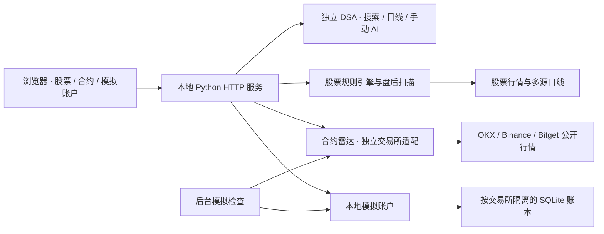

# 观市 · Market Studio

面向 **A 股、美股与 USDT 永续合约** 的本地市场研究工作台，整合行情图表、量价信号、A 股盘后筛选、合约方向雷达、自动模拟交易与手动 AI 分析。

股票与合约使用独立的数据和规则链路。合约默认优先 **欧易 OKX**，支持切换币安 Binance 与 Bitget；欧易和币安分别维护本地模拟账户，欧易加密币与美股合约也按独立账本保存。

> 本项目用于研究、观察与模拟验证，不构成投资建议。自动开平仓仅作用于本地虚拟账户，不向券商或交易所发送真实委托。

## 目录

- [功能与支持范围](#功能与支持范围)
- [快速开始](#快速开始)
- [使用流程](#使用流程)
- [信号与策略规则](#信号与策略规则)
- [自动模拟交易](#自动模拟交易)
- [数据来源与时间口径](#数据来源与时间口径)
- [系统架构与目录](#系统架构与目录)
- [配置说明](#配置说明)
- [本地 HTTP API](#本地-http-api)
- [运行维护与数据保存](#运行维护与数据保存)
- [验证与测试](#验证与测试)
- [常见问题](#常见问题)
- [研究边界与扩展说明](#研究边界与扩展说明)

## 功能与支持范围

| 模块 | 市场 / 产品 | 主要能力 |
|---|---|---|
| 行情研究 | A 股、美股 | 名称 / 代码搜索、日 K、成交量、MA5 / MA20、浏览器自选、手动 AI 报告 |
| 股票盘中信号 | 沪深普通 A 股、美股 | 日线量价方向、已收盘 15 分钟状态、条件式进场带、止损与目标参考 |
| A 股明日盯盘 | 热榜过滤股票池 | 盘后筛选、策略候选 / 观察池、次日点位计划、明日观察列表 |
| A 股盘后复盘 | 指数、市场宽度、板块 | 指数表现、涨跌家数、板块冷热与次日观察提示 |
| 美股雷达 | 美股原股 / USD | 独立观察池、盘前 / 盘中 / 盘后、新浪分钟 OHLCV、Nasdaq 分时与可选 Massive |
| 合约雷达 | USDT 永续 | 三所独立行情、六个分钟周期及 4 小时方向、结构点位、资金费率与持仓估算 |
| 自动模拟交易 | OKX、Binance 合约 | 自动模拟开平仓、费用与滑点、持仓估值、账户恢复、交易记录与盈亏汇总 |
| 历史研究 | A 股、美股样本 | 日线与分钟回放、规则比较、公开样本导入和覆盖审计 |

### 交易所覆盖

| 来源 | 雷达观察范围 | 自动模拟 | 默认行为 |
|---|---|---|---|
| **欧易 OKX** | 24 个加密币 + 6 个股票合约 | 支持，独立账本 | 行情与模拟页面默认来源 |
| 币安 Binance | 24 个加密币 | 支持，独立账本 | 手动切换；新账户初始暂停 |
| Bitget | 24 个加密币 + 6 个股票合约 | 当前未接入 | 可选行情来源 |

观察池是预定义名单，各交易所实际可用范围以接口返回为准。未上线、暂停交易、行情缺失或数据不完整的标的会显示不可用或待确认。

### 加密币分类

| 分类 | 观察标的 |
|---|---|
| 主流 | BTC、ETH、BNB、XRP、LTC、BCH |
| 公链 | SOL、ADA、AVAX、DOT、ATOM、NEAR、APT、SUI、TRX、ETC |
| Layer 2 | ARB、OP |
| DeFi | LINK、UNI、AAVE |
| Meme | DOGE、WIF |
| 基础设施 | FIL |

股票合约名单为 MU、NVDA、TSLA、SNDK、AMD、AAPL。合约页面使用交易所实际合约行情；股票研究页使用原股行情，两者可能存在价差和交易时段差异。

## 快速开始

### 环境要求

- Python 3.10 或以上、Git，以及可运行 Bash 的环境；本地功能验收使用过 Python 3.13 与 macOS。
- 浏览器能够访问本机服务；行情采集需要连接所选数据提供方。
- 前端为静态 HTML / CSS / JavaScript，无需前端构建或 `npm install`。运行前端测试时需要 Node.js。
- 完整股票研究与 AI 功能通过独立的 [Daily Stock Analysis（DSA）](https://github.com/ZhuLinsen/daily_stock_analysis) 服务提供，其依赖安装在独立虚拟环境中。

### 方式一：完整工作台

以下示例检出当前功能分支 `feature/us-live-market-data`：

```bash
git clone --branch feature/us-live-market-data https://github.com/476139183/ai-MarketDashboard.git
cd ai-MarketDashboard
bash start-web.sh
```

首次运行会准备独立 DSA 环境，再启动工作台。安装脚本锁定已核验的 DSA 提交 `db0570edd008a319d7eff14eda3bc0ef9da620eb`，默认保存在 `.cache/daily-stock-analysis/`，不会将上游依赖安装进看板环境。

默认打开 `http://127.0.0.1:8766/research`。可选参数：

```bash
bash start-web.sh --no-open             # 运行服务，不自动打开浏览器
bash start-web.sh --port 8767           # 使用其他本地端口
bash start-web.sh --port 8767 --no-open
```

如已有 DSA 服务，先配置 `DSA_BASE_URL`，再运行启动入口。自建 DSA 的安装、认证和模型配置见 [DSA 接入说明](docs/dsa-integration.md)。

### 方式二：仅运行合约雷达与模拟交易

合约模块不依赖 DSA、模型服务或交易所 API Key，可直接启动本地服务：

```bash
BOARD_PORT=8766 python3 markets/us/dashboard/app.py
```

随后打开：

- 合约雷达：`http://127.0.0.1:8766/contracts`
- 模拟交易：`http://127.0.0.1:8766/paper`

看板服务及公开合约适配使用 Python 标准库。此启动方式不会自动加载根目录 `.env`；需要股票服务配置时，应先导出环境变量。

### 页面导航

下表按默认 `8766` 端口列出，使用其他端口时替换地址即可。

| 页面 | 地址 | 用途 |
|---|---|---|
| 行情研究 | http://127.0.0.1:8766/research | 搜索股票、日 K 与 AI 报告 |
| 股票盘中信号 | http://127.0.0.1:8766/ | 15 分钟规则状态与条件进场观察 |
| A 股明日盯盘 | http://127.0.0.1:8766/a-radar | 盘后生成次日观察名单 |
| A 股盘后复盘 | http://127.0.0.1:8766/a-review | 市场与板块复盘 |
| 美股雷达 | http://127.0.0.1:8766/us-radar | 原股美元行情，按美东时段观察 |
| 合约雷达 | http://127.0.0.1:8766/contracts | 默认欧易，可切币安 / Bitget |
| 自动模拟交易 | http://127.0.0.1:8766/paper | 默认欧易模拟账户 |
| 美股合约模拟 | http://127.0.0.1:8766/paper?market=stock | 欧易股票合约；独立账户，默认暂停 |
| 币安模拟账户 | http://127.0.0.1:8766/paper?exchange=binance | 独立本金、持仓和流水 |

## 使用流程

### 股票研究与 AI 分析

1. 在「行情研究」输入名称或代码，例如「英伟达」、`NVDA`、`600519`。
2. 从候选结果选择市场与标的，点击确认，读取日 K 与盘中判断。
3. 按需加入自选；浏览器本地保存自选列表。
4. 如需 AI 解读，在页面手动选择并保存 API、Codex CLI 或 Claude Code CLI 调用方式，再点击生成报告。

读取行情、切换股票和查询已有任务不会自动生成新的 AI 报告。任务与报告按股票隔离，AI 解读不覆盖规则引擎的进出场条件。

### A 股盘后观察

在「明日盯盘」刷新名单，检查信号日、市场过滤、均线和量能条件，再将关注标的加入明日观察。盘中刷新通常使用前一个完整交易日；北京时间 **15:05 后**才允许纳入当日收盘数据，仍需通过源数据与日历检查。

「盘后复盘」展示指数、涨跌家数和板块冷热，不自动调用大模型。命令行入口：

```bash
python3 markets/a/radar.py
python3 markets/a/market_review.py
```

「盯住」用于维护观察列表，不自动创建开盘提醒或模拟委托。

### 合约观察与模拟验证

1. 打开「合约雷达」，默认读取欧易 USDT 永续。
2. 使用代码 / 名称、加密分类和方向筛选；点击标的查看依据、失效条件及所选周期的已收盘 K 线。
3. 检查报价时间与结构收盘时间。冷启动需要批量加载 K 线，可能等待数十秒。
4. 进入对应交易所的模拟账户，核对规则后启用自动模拟。

切换交易所时同步切换行情口径。欧易与币安账户相互独立；网页切换不会迁移资金、复制持仓或清空历史。未显式指定来源的入口始终优先欧易。

## 信号与策略规则

### 股票盘中信号

当前股票实时规则版本为 `daily-volume-v2.1`，采用以下分层判断：

```text
日线量价方向 → 已收盘 15m 状态 → 报价与数据质量检查 → 条件进场计划
```

- 日线价格、MA20 / MA60、斜率、结构和成交量用于确定总体方向。
- 已收盘 15 分钟结构、EMA5 / EMA13、VWAP 及量能用于识别盘中状态。
- 新鲜报价、量价一致、入场区间及最差入场盈亏比检查共同约束进场；最低盈亏比门槛为 `1.5`。
- 美股包含 `open_drive`、`rebound_fail` 等趋势日早段空形态。
- A 股分别处理午休、非连续交易时段、T+1 与涨跌停限制；普通现货默认仅研究做多，新买入需接受隔夜风险。

页面中的「有方向」「满足形态」「到价可执行」代表不同状态。原股上的做空研究信号也不意味着用户具备融券权限或可直接成交相应合约。

### A 股明日盯盘

从当前人气榜 / 飙升榜过滤池筛选，而非扫描全市场全部股票。现行过滤包含当前名称状态、流通市值与近 20 日估算流动性，具体实现见 `markets/a/large_universe.py`。

| 输出 | 判断含义 |
|---|---|
| 策略候选 | 趋势规则成立，且沪深 300 收盘位于 MA20 上方 |
| 观察池 | 存在技术信号，但市场过滤或趋势条件尚未全部通过 |
| 次日点位计划 | MA5 / MA10 回踩参考、MA20 下方风险参考、结构目标与检查清单 |

点位计划由确定性规则生成：主要回踩参考为 MA5 / MA10，止损参考为 `MA20 × 0.98`，目标参考取此前近 20 根高点与信号日收盘价 `× 1.05` 的较大值；MA5 正乖离超过 `5%` 会提示不追高。这些值是观察预案，不代表次日一定存在可成交价格。

### 合约多周期方向

合约雷达支持 **1 / 5 / 10 / 15 / 30 / 60 分钟**，保留默认 **4 小时** 周期。仅使用所选周期完整、连续且已收盘的 K 线；10 分钟由两根完整 5 分钟线聚合，缺子线不补造。周期同时作用于方向、详情、K 线图与有效性校验。页面刷新另提供 **1 / 5 / 10 / 15 / 30 / 60 秒**；页面轮询不绕过服务端采集节流。

| 方向 | 条件 |
|---|---|
| 看涨 | 最近收盘价 > EMA20 > EMA50，且 EMA20 较 6 根前上升 |
| 看跌 | 最近收盘价 < EMA20 < EMA50，且 EMA20 较 6 根前下降 |
| 观望 | 行情与结构有效，但方向条件未形成一致排列 |
| 待确认 | 报价过期、源异常、K 线不足或存在缺口等，暂停方向 |

至少需要 **60 根完整 K 线**，并覆盖最近已结束的所选周期。未收盘 K 线不参与方向；OKX 额外检查 `confirm=1`，币安检查 K 线收盘时间。

支撑 / 阻力分别参考最近 20 根完整 K 线的最低 / 最高价；已不处于现价相应侧的点位留空。它们是结构参考，不是自动预测的未来目标。

### 美股原股雷达与扩展时段

`/us-radar` 独立观察美股原股，使用既有美股观察列表、每页 8 只，支持池外代码查询、六档分钟周期、六档页面刷新和时段筛选。原股价格单位为 USD，不与交易所 USDT 股票永续合约混用。

| 美东时段 | 时间 | 展示方式 |
|---|---|---|
| 盘前 | 04:00–09:30 | 独立统计当前数据日期的分时点 / K 线数量及最后源时间 |
| 盘中 | 09:30–16:00 | 与盘前、盘后分开对齐聚合；趋势参考只使用已完成 K 线 |
| 盘后 | 16:00–20:00 | 独立筛选；不得用常规盘收盘价冒充盘后最新价 |

时区使用 `America/New_York` 自动处理夏令时；节假日、临时停市及提前收市以源数据为准，页面时钟不充当交易所日历。覆盖数量只表示已取得多少数据，不表示每段交易均完整。休市或源时间不足时显示参考价与待确认方向。

默认自动模式：配置 `MASSIVE_API_KEY` 时优先 Massive；未配置时，常规盘及全部时段模式优先使用新浪真实分钟 OHLCV，盘前 / 盘后筛选使用 Nasdaq 分时备用。可显式选择 Yahoo / yfinance，失败回退 Nasdaq。Massive 请求失败同样回退分时采样并展示提示，不拼接不同来源的 OHLCV。

- **新浪美股分钟线**：无需 Key，提供常规盘真实 OHLCV。接口以美东 K 线结束时间标记，本地转换为起点后聚合；每根量柱单位为股。实际延迟以源 K 线时间为准，接口可用不代表零延迟。失败时回退 Nasdaq 并显示提示。
- **Nasdaq 公开备用**：无需 Key，报价与分时分别请求。分时图只画价格采样线；没有真实 OHLCV 时不生成 K 线、成交量或趋势信号。报价没有分时戳时保留源日期，明确标为参考。
- **Massive 分钟 OHLCV**：通过官方聚合接口获取真实 OHLCV；API Key 只存服务端环境，浏览器不接触密钥。可用历史、实时 / 延迟范围取决于账户订阅，配置 Key 不等于获得实时权限。
- **Yahoo / yfinance**：作为显式可选链路，申请扩展时段分钟线；公开源可能限流、缺量或缺少时段，回退来源始终显示。

10 分钟从完整 5 分钟聚合，60 分钟从完整 30 分钟聚合；各时段以自身开始时间对齐，不将隔夜或周末拼入单根 K 线。常规盘最后不足 60 分钟的分组排除。只有报价与当前时段结构足够新鲜、至少取得 60 根真实完整 K 线时才展示 EMA20 / EMA50 趋势倾向；它与原盘中信号页的固定策略分别运行。美股雷达列表按查询组合缓存至少 60 秒；所选单股图表独立每 15 秒采集，页面 1 秒刷新不会产生每秒外部抓取。

接口依据：[Massive OHLCV](https://massive.com/docs/rest/stocks/aggregates/custom-bars)、[扩展时段数据说明](https://massive.com/knowledge-base/article/does-massive-offer-pre-market-and-after-hours-data)。

### 实时图表与成交量

美股雷达与合约雷达使用价格 / 成交量联动图，支持拖动、缩放及悬停查看开、高、低、收、量。形成中的 K 线会明确标记，继续随采集结果更新；图表更新不会将未收盘数据送入方向计算或模拟交易。更新采用 REST 轮询，合约约 10 秒、所选美股约 15 秒，非逐笔 WebSocket 推送；交易所和公开源的实际延迟另外显示。

美股量柱使用真实每根成交股数；源日累计量另标 Nasdaq 来源及数据日期，缺失时留空。合约量柱使用基础币数量，OKX 从接口基础币成交量字段读取，不将合约张数当成基础币数量。分时采样没有逐根 OHLCV 时仅画价格线，清空量柱并明确提示成交量未提供，不用累计量差分或零填充代替真实量。

新浪免费分钟线目前验证了 SNDK 常规盘 1 / 5 / 15 / 60 分钟数据，10 分钟由完整 5 分钟聚合。盘前 / 盘后的真实分钟量尚未获得可验收的免费源；可配置 Massive，覆盖及延迟取决于订阅权限。百度财经页面可作为展示参考，本次公开接口探测返回 403，未作为已接通来源。

## 自动模拟交易

### 默认参数

| 参数 | 当前设定 |
|---|---|
| 每个账户初始本金 | 10,000 USDT 虚拟资金 |
| 单笔名义预算 | 约 1,000 USDT，按数量规则向下取整 |
| 同时持仓上限 | 每个账户 3 仓，每标的最多 1 仓 |
| 敞口模型 | 1 倍名义预算，不实现交易所全仓 / 逐仓强平机制 |
| 入场方向 | 4 小时看涨做多，看跌做空 |
| 固定止损 / 止盈 | 相对模拟开仓价 2% / 4% |
| 手续费假设 | 每边 0.06% |
| 不利滑点假设 | 每边 0.05% |
| 后台检查 | 每 5 秒检查，行情采集最短间隔 10 秒 |
| 规则版本 | `closed-4h-ema-v1` |

模拟页面可选择「加密货币 / 美股合约」。美股合约目前仅使用欧易股票永续；币安仅支持加密货币。新美股合约账户独立虚拟本金 10,000 USDT、初始暂停；原欧易 / 币安账本保留。类型只限制新开仓，历史跨类仓位继续管理，记录不会因切换类型删除。**模拟策略固定为原 4 小时规则，雷达切换分钟周期不会改变现有账户策略。**

参数定义位于 `markets/us/dashboard/paper_trading.py` 的 `RULES`。费用与滑点是研究假设，不代表交易所或用户实际费率；当前页面不提供在线参数编辑。

### 成交流程

1. 首次观察到有效方向，记录信号与观察时间。
2. 等待观察时间之后的新鲜盘口报价，检查资金、持仓额度与数量约束。
3. 做多按卖一、做空按买一模拟入场，并施加不利滑点和手续费。
4. 后续新鲜盘口触发止损、止盈，或完整结构下方向失效时模拟退出。
5. 平仓使用当时可成交侧报价及滑点，记录净盈亏、费用、信号与退出原因。

同一「标的 / 4 小时收盘周期 / 方向」最多开仓一次；同一次检查中不会平仓后立即反向开仓。有限仓位按观察列表顺序分配，不做跨信号收益择优。

欧易按合约面值、最小张数及步长计算数量；币安按基础币数量步长计算，并检查最小 / 最大数量及最小名义金额。币安基础币数量与欧易合约张数分别显示。

### 账户状态与账目

| 操作 / 状态 | 实际行为 |
|---|---|
| 首次创建账户 | 暂停，零持仓；已有账本恢复其原状态 |
| 启用自动模拟 | 后台持续检查对应交易所信号并模拟成交 |
| 暂停新开仓 | 禁止新开仓；已有仓位继续执行退出规则 |
| 关闭网页 | 本地服务运行期间，已启用账户继续运行 |
| 停止服务 | 停止检查；停机期间不补造历史成交 |
| 重启服务 | 恢复启用状态、仓位、信号去重记录和历史 |
| 报价或盘口失效 | 暂停对应撮合，保留持仓与最后估值 |

```text
估算权益 = 可用现金 + 持仓冻结名义本金 + 浮动盈亏
已实现净盈亏 = 已平仓价格盈亏 − 开仓费用 − 平仓费用
```

浮动盈亏按最后有效的退出侧报价估算，尚未扣除未来退出费用；报价过期时页面标记上次估值。页面列出最近 100 条平仓记录，统计汇总包含完整历史。

目前未计入资金费用、市场深度冲击、真实强平和拆股处理，也不能保证捕捉两次采样之间的每次触价。跳空按当前盘口退出，不按已经错过的止损价补造成交。

## 数据来源与时间口径

### 股票日线

`feeds/` 按配置顺序尝试提供方，缺包、缺 Token、源失败或数据不合法时继续尝试后续来源。

| 市场 | 默认优先顺序 |
|---|---|
| A 股 | DSA → 腾讯 → AKShare → BaoStock → Tushare → 新浪 |
| 美股 | DSA → Yahoo Chart → yfinance → Alpha Vantage → Finnhub |

可选开启第二来源收盘价交叉核对。日线级联独立于股票分钟线 / 报价链路，也不用于交易所合约回退。数据来源、复权口径和覆盖日期应结合返回结果核验。

### 合约数据

| 数据项 | OKX | Binance | Bitget |
|---|---|---|---|
| 产品 | USDT 线性永续 | 在交易的 USDT 加密永续 | USDT 永续 |
| 价格 | 同一合约最新成交价 | USD-M 合约最新成交价 | 同一合约最新成交价 |
| 24h 成交额 | 基础币量 × 现价估算 | 接口 `quoteVolume` | 接口 USDT 成交额 |
| 当前资金费率 | 公开 funding-rate | premiumIndex | 合约 ticker |
| 名义持仓估算 | 基础币持仓量 × 标记价 | 基础币持仓量 × 标记价 | 基础币持仓量 × 标记价 |
| 模拟数量单位 | 合约张数及基础币 | 基础币 | 当前不用于模拟账户 |

资金费率展示当前周期值，不作统一年化。持仓估算是市场未平仓量的名义价值，不是用户账户仓位。币安持仓量在后台缓存；尚未取得或过期时留空。

### 新鲜度与缓存

- 合约报价有效窗口为 **30 秒**；缺失、超期或时间异常时撤销方向。
- 币安使用 ticker 与盘口时间的较早值，不用请求接收时间替代源时间。
- 合约 K 线缓存 60 秒，跨所选周期边界重新获取；长冷扫描结束后重新取报价。
- 页面默认每 10 秒刷新，可选 1 / 5 / 10 / 15 / 30 / 60 秒并暂停；服务端最短采集间隔为 10 秒。
- UI 区分报价时间、结构收盘时间和采集时间；页面主要使用北京时间展示。
- 三所独立缓存与报错，不跨所填补报价、资金费率或 K 线。

公开源可能延迟、断开或限流。当前没有覆盖所有市场的统一交易所节假日日历；数据不足时保持观望或待确认。

官方接口说明：[OKX](https://www.okx.com/docs-v5/en/)、[Binance USD-M](https://developers.binance.com/en/docs/catalog/core-trading-derivatives-trading-usd-s-m-futures/api/rest-api/market-data)、[Bitget 合约行情](https://www.bitget.com/docs/catalog/classic-contract-market/classic-contract-market)。

## 系统架构与目录



浏览器只访问本地 HTTP API；行情与 AI 服务调用由后端处理。AI 报告、股票条件信号、合约方向和模拟成交各自保留规则与状态。

```text
.
├── README.md
├── start-web.sh                     # 完整工作台入口，默认 8766
├── start-dsa.sh                     # 独立 DSA 安装与启动
├── start-dashboard.sh               # 单独股票看板入口，默认 8765
├── start-watch.sh                   # 股票信号后台巡检
├── .env.example                     # 本地配置模板
├── feeds/                           # A / 美股多源日线及归一化
├── market-analysis/                 # 市场识别、规则参考与技能入口
├── markets/
│   ├── a/                           # A 股雷达、复盘和独立历史研究
│   └── us/
│       ├── public_history.py        # 公开历史样本导入与审计
│       └── dashboard/
│           ├── app.py               # 本地页面与 HTTP API
│           ├── engine.py            # 股票信号组装与行情接入
│           ├── market_states.py     # 日线量价及 15m 状态规则
│           ├── contract_radar.py    # 合约方向规则、观察池及缓存
│           ├── okx_contracts.py     # OKX 适配
│           ├── binance_contracts.py # Binance 适配
│           ├── sina_intraday.py     # 新浪美股真实分钟 OHLCV
│           ├── us_radar.py          # 美股原股、扩展时段与来源回退
│           ├── radar_periods.py     # 雷达周期与完整聚合
│           ├── paper_trading.py     # 模拟账户、账本及后台检查
│           ├── static/              # 页面、样式、脚本与本地图表依赖
│           └── cache/               # 本地缓存和模拟账本，Git 忽略
└── docs/                            # 数据接入、验证报告与设计说明
```

Bitget 公开行情适配位于 `contract_radar.py`。图表使用本地打包的 Lightweight Charts；版本、许可与署名说明见 [前端依赖说明](markets/us/dashboard/static/vendor/README.md)。

## 配置说明

### 环境变量

首次配置可将 `.env.example` 复制为 `.env`；已有配置时编辑原文件。`start-web.sh` 自动读取模板中列出的 DSA 与日线源配置，已导出的环境变量优先。

| 配置项 | 用途 / 默认值 |
|---|---|
| `DSA_BASE_URL` | DSA 服务根地址；完整启动入口默认 `http://127.0.0.1:8000` |
| `DSA_SESSION_COOKIE` | DSA 开启认证时使用的服务端会话凭证 |
| `DSA_CHECKOUT_DIR` | 独立 DSA 目录；默认 `.cache/daily-stock-analysis` |
| `DSA_PORT` | 单独启动 DSA 时的端口，默认 `8000` |
| `BOARD_PORT` | 直接运行 `app.py` 时的端口，默认 `8765`；`start-web.sh` 通过 `--port` 设置 |
| `CN_DAILY_SOURCES` | A 股日线提供方优先顺序，逗号分隔 |
| `US_DAILY_SOURCES` | 美股日线提供方优先顺序，逗号分隔 |
| `FEEDS_CROSSCHECK` | `1` 时启用下一来源交叉核对；默认关闭 |
| `TUSHARE_TOKEN` | 可选 Tushare 凭证 |
| `ALPHAVANTAGE_API_KEY` | 可选 Alpha Vantage 凭证 |
| `FINNHUB_API_KEY` | 可选 Finnhub 凭证 |
| `MASSIVE_API_KEY` | 可选美股雷达分钟 OHLCV 凭证；未配置时使用 Nasdaq 分时采样 |
| `SIGNAL_LIVE` | 股票看板强制刷新行情；不改变合约雷达的独立刷新逻辑 |

直接执行 `app.py` 或股票巡检时，可显式导入配置：

```bash
set -a
source .env
set +a
BOARD_PORT=8766 python3 markets/us/dashboard/app.py
```

`DSA_PORT` 与 `DSA_BASE_URL` 需一致，例如在启动完整工作台前设置：

```bash
DSA_PORT=8001 DSA_BASE_URL=http://127.0.0.1:8001 bash start-web.sh
```

### 可选依赖与 AI 配置

```bash
python3 -m pip install -r requirements-feeds.txt      # 可选股票行情适配包
python3 -m pip install -r requirements-research.txt   # 公开 Parquet 样本研究
```

DSA 的模型与可选新闻服务配置位于其独立目录的 `.env`，默认路径为 `.cache/daily-stock-analysis/.env`。看板根目录 `.env` 与 DSA `.env` 的职责不同。

模型调用方式必须在页面手动选择并保存。模型凭证由本地服务端保存，前端不应存储密钥；`.env`、行情缓存和模拟账本不纳入代码提交。

## 本地 HTTP API

以下均相对于看板根地址。接口用于本地工作台，默认监听 `127.0.0.1`，未提供多用户账户或交易权限系统。

| 方法 | 路径 | 用途 |
|---|---|---|
| GET | `/api/health` | 看板健康状态 |
| GET | `/api/watchlist` | 默认股票观察池 |
| GET | `/api/signals?symbols=NVDA,MU` | 股票条件信号集合 |
| GET | `/api/market-state?symbol=600519` | 单标的股票规则状态 |
| GET | `/api/alerts` | 股票巡检告警快照 |
| GET | `/api/a-radar` | A 股次日名单；`refresh=1` 请求后台更新 |
| GET | `/api/a-review` | 盘后复盘；`refresh=1` 请求后台更新 |
| GET | `/api/us-radar?symbols=NVDA,MU&period=15&session=all&provider=auto` | 美股原股；最多 8 代码，时段 `all/pre/regular/post`，来源 `auto/sina/nasdaq/massive/yahoo` |
| GET | `/api/us-chart?symbols=SNDK&period=5&provider=auto` | 单股价格 / 成交量图，独立 15 秒采集，含形成中 K 线；参数同美股雷达 |
| GET | `/api/contracts?exchange=okx&period=240` | 合约雷达；三交易所，周期 `1/5/10/15/30/60/240` |
| GET | `/api/paper?exchange=okx&market=crypto` | 模拟账户；类型 `crypto/stock`，`stock` 只支持 `okx` |
| POST | `/api/paper/control` | JSON `enabled`、`exchange`、`market`；启用或暂停所选账户新开仓 |
| GET | `/api/dsa/search?q=英伟达` | 股票名称 / 代码候选 |
| GET | `/api/dsa/history?symbol=NVDA&days=90` | 股票日线 |
| GET | `/api/dsa/config` | 分析服务与模型可用状态 |
| POST | `/api/dsa/analysis` | 手动提交 AI 分析任务 |
| GET | `/api/dsa/status?task_id=…` | 查询已有任务 |
| GET / POST | `/api/dsa/ai-settings` | 查询 / 保存 AI 调用方式 |
| GET | `/api/history-samples` | 本地历史样本覆盖审计 |

示例：读取币安合约及其独立模拟账户。

```bash
curl 'http://127.0.0.1:8766/api/contracts?exchange=binance'
curl 'http://127.0.0.1:8766/api/paper?exchange=binance'
```

示例：启用币安虚拟账户。执行此请求后，本地服务会开始自动模拟交易。

```bash
curl -X POST 'http://127.0.0.1:8766/api/paper/control' \
  -H 'Content-Type: application/json' \
  -d '{"exchange":"binance","enabled":true}'
```

暂停时将 `enabled` 改为 `false`。省略 `exchange` 时默认选择欧易。合约雷达响应可能先返回 `status=running`；客户端应继续查询进度，不应将首屏空列表解释为无可用市场。

## 运行维护与数据保存

### 服务与日志

| 项目 | 位置 / 行为 |
|---|---|
| 完整启动入口 | `start-web.sh`；复用已运行的工作台，Ctrl+C 停止本次创建的子服务 |
| 看板日志 | 完整启动时写入 `.cache/web-dashboard.log` |
| DSA 日志 | 完整启动时写入 `.cache/dsa-service.log` |
| 欧易模拟账本 | `markets/us/dashboard/cache/paper-trading.sqlite3` |
| 欧易美股合约账本 | `markets/us/dashboard/cache/paper-trading-okx-stock.sqlite3` |
| 币安模拟账本 | `markets/us/dashboard/cache/paper-trading-binance.sqlite3` |
| A 股名单 / 复盘 | `markets/a/radar-latest.json`、`markets/a/market-review-latest.json` |
| 美股公开样本库 | `markets/us/.cache/public-history.sqlite3` |

备份模拟账户前先正常停止本地服务，再复制对应 SQLite 文件。账本包含资金、持仓、待处理信号和历史；重新克隆 Git 仓库不会带回本地账本。恢复时保持文件与交易所对应，程序会拒绝交易所指纹不一致的账本。

部分 A 股 JSON 快照纳入版本管理，主动刷新后可能产生 Git diff。行情缓存、模拟账户和密钥配置使用独立的忽略路径。

### 股票后台巡检

```bash
bash start-watch.sh --once    # 前台扫描一轮
bash start-watch.sh           # 后台持续巡检
bash start-watch.sh --stop    # 停止巡检
```

巡检读取 `markets/us/dashboard/watchlist.txt`，维护本地告警文件；macOS 下可发送桌面通知。它与合约模拟后台是不同进程，不会自动向真实账户下单。

旧入口 `start-dashboard.sh` 默认使用 `8765`，并包含终止指定端口旧进程的逻辑。常规使用建议选择 `start-web.sh`；仅运行合约时使用上面的直接启动命令。自定义直接启动端口应使用实际被 `app.py` 读取的 `BOARD_PORT`。

## 验证与测试

### 常规回归

在仓库根目录执行：

```bash
python3 -m unittest discover -s feeds -p 'test_*.py'
python3 -m unittest discover -s markets/a -p 'test_*.py'
python3 -m unittest discover -s markets/us/dashboard -p 'test_*.py'
node --test markets/us/dashboard/test_*.cjs
```

合约与模拟账户专项：

```bash
python3 -m unittest discover -s markets/us/dashboard -p 'test_contract*.py'
python3 -m unittest discover -s markets/us/dashboard -p test_okx_contracts.py
python3 -m unittest discover -s markets/us/dashboard -p test_binance_contracts.py
python3 -m unittest discover -s markets/us/dashboard -p 'test_paper*.py'
```

验证覆盖行情归一化、已收盘 K 线、过期报价、源切换、冷扫描、延后成交、信号去重、多空盈亏、费用、数量限制、事务并发、重启恢复，以及页面搜索、分类、账户控制和工作区切换。

### 最近功能验收记录

2026-11-07 的功能验收包含：币安 24/24 新鲜报价、欧易默认入口、分类筛选、合约 10 分钟实盘结构与 30/30 新鲜报价、NVDA / MU 三时段各 960 个 Nasdaq 分时点、390px 手机布局、美股代码 / 时段切换及独立暂停的美股合约模拟账户。Massive 尚未配置真实 API Key，完成接口传输替代测试，未宣称已通过账号实测。

新增雷达周期、美股雷达和模拟市场选择后的看板 Python 共发现 165 项测试，163 项通过；以下 2 项既有 DSA 兼容测试仍失败，不能将全量套件描述为全部通过：

- `test_engine_maps_daily_dates_to_new_york_and_does_not_forge_quote`
- `test_six_month_request_preserves_requested_history_window`

前端 36 项测试通过。完整上下文见 [币安扩展设计与验收](docs/plans/2026-11-07-binance-crypto-contracts-design.md)。单元测试使用替代 HTTP 传输验证逻辑；真实行情连通性与浏览器布局另行验收。

## 常见问题

| 现象 | 检查方式 |
|---|---|
| 首次启动耗时较长 | 完整模式需要安装 DSA 依赖；只使用合约时可采用无 DSA 的直接启动方式 |
| 端口被占用 | 完整入口使用 `--port`；直接启动使用 `BOARD_PORT`，并更新浏览器地址 |
| 股票搜索 / 日 K 无法读取 | 检查 DSA 是否运行、`DSA_BASE_URL` 是否为根地址，以及认证 Cookie 是否有效 |
| 行情可用但 AI 按钮不可用 | 检查是否手动选择并保存调用方式、模型或本机 CLI 是否可用 |
| 合约首屏空白或一直更新 | 等待首次批量 K 线读取，核对源错误和网络；冷启动不等同于持续无行情 |
| 有价格却显示待确认 | 检查源报价时间、30 秒新鲜度、最近收盘周期与 K 线连续性 |
| 模拟账户没有新仓 | 检查启用状态、有效方向、后续新报价、数量约束、3 仓上限及信号是否已使用 |
| 暂停后仍有仓位 | 暂停仅阻止新开仓；已有仓位等待新鲜盘口和退出条件，不会因暂停被强制平掉 |
| 切换交易所后余额不同 | 欧易和币安各自拥有独立账本与本金，页面展示所选账户 |
| 页面展示旧功能 | 刷新浏览器；修改 Python 服务代码后需要重启相应本地服务 |

## 研究边界与扩展说明

- A 股与美股按各自交易时段和动作约束处理，不能直接套用彼此的成交假设。北交所、ETF、ST、新股及其他特殊产品的识别与策略覆盖并不统一。
- 当前热榜与当前成分回看历史会引入选择、前视和幸存者偏差；现有历史实验不构成严格的独立样本外收益证明。
- 除权、停牌、真实涨跌停队列、盘口深度和所有节假日尚未完整还原。股票日线、分钟行情和合约价格之间不存在统一的实时或复权保证。
- 合约首版支持 USDT 永续，不包含币本位、USDC、期权或交割合约；不同交易所的合约代码、面值和价格单位不能仅按名称合并。
- 模拟记录用于检查规则行为及账目一致性，不能替代真实撮合、资金费结算或账户风险系统。网页尚未提供手动开平仓、账户重置和在线规则调参。

扩展标的时，先维护 `contract_radar.py` 的观察池与分类，再核验提供方是否存在对应产品、价格单位、数量过滤器及足够的历史 K 线。新增交易所需保留原始合约 ID、源时间和数量口径，并补充适配、源隔离与账户测试。

进一步阅读：

| 文档 | 内容 |
|---|---|
| [看板说明](markets/us/dashboard/README.md) | 页面、巡检、合约与模拟交易细节 |
| [DSA 接入](docs/dsa-integration.md) | 上游安装、AI 配置和任务隔离 |
| [数据源说明](docs/market-data-sources.md) | 行情接入与来源比较 |
| [公开历史样本](docs/public-history.md) | 样本导入、覆盖与审计 |
| [A 股研究](markets/a/README.md) | 独立日线、回放、候选台账及偏差说明 |
| [美股市场包](markets/us/README.md) | 美股研究和数据工具 |
| [市场分析技能](market-analysis/SKILL.md) | 市场识别与规则参考入口 |
| [合约雷达设计](docs/plans/2026-11-06-contract-radar-design.md) | 4 小时方向、缓存与数据质量边界 |
| [自动模拟设计](docs/plans/2026-11-06-auto-paper-trading-design.md) | 前向模拟、成交与持久化模型 |
| [币安扩展设计](docs/plans/2026-11-07-binance-crypto-contracts-design.md) | 欧易优先、币种分类与跨所账户隔离 |
